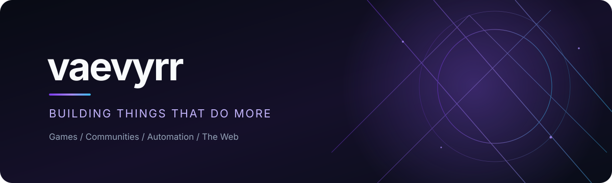

<!--
  vaevyrr GitHub profile
  Edit the project links and social links as your public projects evolve.
-->

# vaevyrr

**Developer · Builder · Problem Solver**

I build tools, bots, game systems, and web projects — mostly around making things work better, feel better, and do more.

---

## About

- Building across **Minecraft Bedrock**, **Discord**, and **web development**
- Interested in automation, APIs, backend systems, game scripting, and clean UI
- Usually working on a few ideas at once — from small utilities to full bot systems
- I like learning by building, testing, breaking things, and fixing them

## What I work with

## Featured work

| Project area | What I build |
|---|---|
| **Minecraft Bedrock** | Add-ons, Script API features, custom items, gameplay systems, and Realm utilities |
| **Discord bots** | Moderation tools, server utilities, announcements, automation, and music experiments |
| **Web & backend** | OAuth flows, API integrations, Cloudflare Workers, and application backends |
| **Python & JavaScript** | Scripts, diagnostics, integrations, and tools that automate repetitive work |

> More project repositories and public demos will be added here as they are ready to share.

## GitHub stats

  
  

  

## Contribution graph

  

## Currently exploring

- Better game scripting and Bedrock add-on architecture
- Reliable Discord bot systems and integrations
- Authentication, APIs, and lightweight backend services
- Automation that makes community management easier

---

**Thanks for stopping by.**

[GitHub](https://github.com/vaevyrr) · [Repositories](https://github.com/vaevyrr?tab=repositories)

Designed in a dark theme · Built with curiosity

